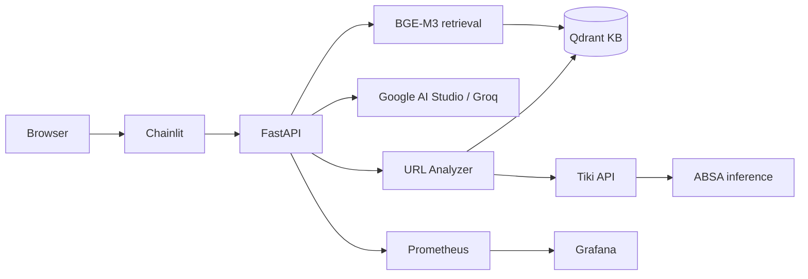

# Tiki Sentiment Chatbot

[](https://github.com/KhoiDang-KHDL/Tiki-Sentiment-Chatbot/actions/workflows/ci.yml)


Hệ thống hỏi đáp sản phẩm Tiki kết hợp **Retrieval-Augmented Generation (RAG)** và
**Aspect-Based Sentiment Analysis (ABSA)**. FastAPI phục vụ retrieval, phân tích URL
và sinh câu trả lời; Chainlit cung cấp giao diện hội thoại. Airflow xử lý review batch
để cập nhật Knowledge Base incremental.

## 1. Chức năng

- Tìm sản phẩm bằng ngôn ngữ tự nhiên, lọc theo giá, rating, loại tài liệu và điểm ABSA.
- Trả lời có nguồn tham khảo, hỗ trợ streaming và hội thoại nhiều lượt.
- Phân tích URL Tiki từ KB hoặc crawl review mới và chạy ABSA.
- Cập nhật review theo batch, rebuild tài liệu của sản phẩm bị ảnh hưởng và upsert Qdrant.
- Theo dõi API/streaming bằng Prometheus, Grafana; kiểm tra tải bằng Locust.
- Kiểm tra code, DAG và container integration tự động bằng GitHub Actions.

Sáu khía cạnh ABSA: **chất lượng, giá cả, mô tả, dịch vụ, đóng gói, giao hàng**.

## 2. Kiến trúc hệ thống



| Lớp | Thành phần | Trách nhiệm |
|---|---|---|
| UI | Chainlit, HTTP/SSE client | Nhận query/URL, quản lý history và context của phiên |
| API | FastAPI, một uvicorn worker | Validation, điều phối retrieval/LLM, URL context, metrics |
| Retrieval | BGE-M3, Qdrant | Dense search, metadata filters, ABSA reranking |
| Inference | LogReg, PhoBERT, ONNX Runtime | Dự đoán sentiment theo khía cạnh |
| Generation | Google AI Studio hoặc Groq | Query rewriting và trả lời theo tài liệu truy xuất |
| Data pipeline | Airflow 3.3.2, LocalExecutor | Xử lý CSV batch tuần tự, retry và completion receipts |
| Infrastructure | Docker Compose, PostgreSQL | Runtime services và Airflow metadata |
| Observability | Prometheus, Grafana, Locust | Metrics, alert rules và performance tests |
| CI | GitHub Actions | Python tests, DAG import và container smoke checks |

Redis là cache tùy chọn, bật qua `REDIS_URL`; không phải service bắt buộc của stack hiện tại.

## 3. Data và Knowledge Base pipeline

### 3.1. Incremental processing

```mermaid
flowchart LR
    CSV[Review CSV] --> Queue[Airflow inbox]
    Queue --> Clean[Validate / clean]
    Clean --> Predict[ABSA inference]
    Predict --> Merge[Merge / deduplicate]
    Merge --> Aggregate[Aggregate aspect scores]
    Aggregate --> Delta[Build affected documents]
    Delta --> Index[Embed / upsert / remove stale IDs]
    Index --> Verify[Verify Qdrant payloads]
    Verify --> Done[Done / archive / receipt]
```



DAG `tiki_kb_incremental` có hai task `process_batches → report`, một writer,
retry hai lần và lịch mặc định mỗi 15 phút. DAG khởi tạo ở trạng thái paused.

Batch input là CSV UTF-8 với `product_id,content,rating`; product phải tồn tại trong
`data/raw/products_detail.csv`. Pipeline deduplicate theo product ID và nội dung
đã chuẩn hóa, ghi snapshots/backup, rồi chỉ embed lại các sản phẩm bị ảnh hưởng.

Retry sử dụng stable document IDs và snapshots. Local files/Qdrant không có transaction
chung; batch pending phải hoàn tất trước batch mới. Xem [Incremental KB](source/knowledge_base/INCREMENTAL.md)
và [Airflow](airflow/README.md).

### 3.2. ABSA inference

| Model | Artifact | Sử dụng |
|---|---|---|
| Logistic Regression | `models/logreg/logreg.pkl` | Default cho incremental và URL analysis |
| PhoBERT | `models/phobert/phobert.pt` | Tùy chọn khi có checkpoint và tokenizer/cache |
| PhoBERT ONNX | `models/phobert_onnx/phobert_absa.onnx` | Tùy chọn ONNX Runtime; cần tokenizer local |

Model inference nhận văn bản đã chuẩn hóa. Positive ratio dùng mẫu số
`positive + negative`; neutral không được coi là negative.
Chưa công bố benchmark F1 cho bản tái hiện này.

### 3.3. Document và vector schema

KB gồm `product_card`, `aspect_summary` và `review`. Incremental bổ sung review documents
có stable IDs, giữ metadata/statistics đồng bộ qua các batch.

- Encoder: BGE-M3, dense vector 1.024 chiều, Cosine.
- Collection có dense/sparse schema; serving hiện truy vấn vector `dense`.
- Filters: giá, rating, document type và aspect score; sau đó ABSA reranking.
- BGE-M3 ONNX local là tùy chọn; fallback sang FlagEmbedding.
- `data/processed/documents.jsonl` là canonical export sau incremental.

Baseline local ngày 23/10/2026: collection `tiki_kb_test` có **2.960 points**.
Point count là số documents, không phải số sản phẩm, và thay đổi theo batch.

## 4. Serving và API

Chainlit gọi HTTP API; UI không load model hoặc giữ provider keys.
API khởi tạo retrieval tại startup và giữ context URL trong RAM, TTL một giờ.
Chạy một worker để tránh nhân bản model và phân tán context.

| Endpoint | Chức năng |
|---|---|
| `GET /health` | Trạng thái collection và cấu hình provider |
| `POST /search` | Retrieval, trả documents/sources; không gọi LLM |
| `POST /chat` | Trả answer/sources |
| `POST /chat/stream` | SSE: sources, token, done hoặc error |
| `POST /analyze` | Báo cáo URL và context_id cho câu hỏi tiếp nối |
| `GET /metrics` | Prometheus metrics khi được bật |

`LLM_PROVIDER`: `google`, `groq`, `auto`. Google dùng `GEMINI_API_KEY` hoặc
`GOOGLE_API_KEY`; Groq dùng `GROQ_API_KEY`. Mode `auto` thử Groq trước Google.
URL analysis không tự ghi review mới vào KB; cập nhật KB đi qua pipeline batch.

HTTP 200 không bảo đảm stream thành công: SSE có thể phát `error` sau response headers.
Client chỉ lưu câu trả lời hoàn tất khi nhận `done`.

Chi tiết input, errors và cấu hình: [Chatbot/API](source/chatbot/README.md).

## 5. Cài đặt và vận hành

### 5.1. Prerequisites

- Docker Desktop dùng Linux containers, Compose hỗ trợ `include`.
- Python 3.12 cho script host/CI local; API/ML containers dùng Python 3.11.
- Qdrant container và collection đã khởi tạo; mặc định container `tiki-qdrant`.
- Dữ liệu canonical, checkpoint và Hugging Face cache được chuẩn bị riêng.
- Provider key nếu cần sinh câu trả lời; retrieval không yêu cầu LLM key.

Dữ liệu, model, cache và secrets không được lưu trong Git. Clone repo không tự tạo
KB/checkpoint. Dự trù RAM cho Airflow, API và embedding jobs chạy đồng thời.

### 5.2. Clone và cấu hình

```powershell
git clone https://github.com/KhoiDang-KHDL/Tiki-Sentiment-Chatbot.git
cd Tiki-Sentiment-Chatbot
py -3.12 -m venv .venv
.\.venv\Scripts\python.exe -m pip install python-dotenv==1.2.4
```

Bước cài trên chỉ chuẩn bị script cấu hình host; ML dependencies được build trong Docker.
Đặt provider variables trong process environment hoặc `.env` local trước setup.
Script sinh các file sau khi chưa tồn tại:

| File | Cấu hình |
|---|---|
| `.env.airflow` | Airflow credentials, Qdrant, HF cache và KB settings |
| `.env.docker` | Provider/model/keys và API/UI host ports |
| `.env.monitoring` | Grafana credentials và monitoring ports |

Template: `.env.*.example`. Khi đổi máy, đối chiếu Qdrant container/collection và
`HF_HUB_CACHE_HOST` trong `.env.airflow` với artifact thực tế.

### 5.3. Build, start và kiểm tra

Sau khi đáp ứng prerequisites:

```powershell
Set-ExecutionPolicy -Scope Process -ExecutionPolicy RemoteSigned
.\scripts\stack.ps1 setup
.\scripts\stack.ps1 status
.\scripts\stack.ps1 check
```

Setup build image ML/Airflow trước, sau đó API/UI; giữ Qdrant volume hiện có.
`check` xác nhận UI → API → Qdrant và monitoring, không gọi LLM thật.

```powershell
.\scripts\stack.ps1 start   # Khởi động lại
.\scripts\stack.ps1 logs    # API/UI logs
.\scripts\stack.ps1 stop    # Dừng services, giữ volumes
```

Sửa source API/UI: chạy `stack.ps1 build` rồi `stack.ps1 start`.
Chi tiết persistence, mounts và recovery: [DOCKER.md](DOCKER.md).

## 6. Truy cập services

| Service | Địa chỉ mặc định | Credentials |
|---|---|---|
| Chatbot | [localhost:8001](http://localhost:8001) | Không có auth local |
| API docs | [localhost:8000/docs](http://localhost:8000/docs) | Không có auth local |
| Airflow | [localhost:8080](http://localhost:8080) | `scripts/airflow.ps1 password` |
| Grafana | [Dashboard](http://localhost:3000/d/tiki-api) | `scripts/monitoring.ps1 password` |
| Prometheus | [Targets](http://localhost:9090/targets) | Loopback local |
| Locust | [localhost:8089](http://localhost:8089) | Profile loadtest |

Start Locust: `.\scripts\monitoring.ps1 locust`.
Host ports có thể thay đổi; kiểm tra `stack.ps1 status`. PostgreSQL dùng internal network.

## 7. Monitoring, testing và kết quả

### 7.1. Observability

Prometheus scrape API mỗi 5 giây, giữ dữ liệu 15 ngày. Grafana có 14 panel, tách API thật
và synthetic fixture. Metrics gồm request rate, HTTP errors, p50/p95, active requests,
TTFT, stream outcomes/duration và process CPU/RAM.

Bốn alert rules: API down, HTTP errors, stream failures và p95 cao.
Chưa cấu hình notification channel. Hướng dẫn: [Monitoring](monitoring/README.md).

### 7.2. Offline và integration checks

```powershell
.\scripts\ci.ps1 -Install
.\scripts\airflow.ps1 test
```

Offline suite dùng fixture, temporary files và Qdrant in-memory.
DAG import được kiểm tra trong đúng Airflow runtime. Acceptance UI, live crawl/model và
chất lượng câu trả lời: [Testing](source/chatbot/TESTING.md).

### 7.3. Load testing

```powershell
.\scripts\loadtest.ps1 -Target synthetic -Scenario mixed -Users 10 -Seconds 30 -P95Milliseconds 2000
.\scripts\loadtest.ps1 -Target real -Scenario search -Users 5 -Seconds 45 -WarmupRequests 3
```

Kết quả local ngày **23/10/2026**, một API worker:

| Scenario | Users | Thời gian | Requests tổng | Failures | p95 |
|---|---:|---:|---:|---:|---:|
| Mixed synthetic | 10 | 30s | 298 | 0 | 980 ms |
| Search thật, cold | 1 | 20s | 4 | 0 | 17.000 ms |
| Search thật, warm-up 3 requests | 1 | 45s | 43 | 0 | 610 ms |
| Search thật, warm-up 3 requests | 5 | 45s | 112 | 0 | 2.100 ms |

Request totals gồm health khi khởi tạo user. Bài cold không đạt threshold p95 10s.
Synthetic không đo năng lực embedding/provider thật; các bài ngắn này chưa xác định tải tối đa.
Report HTML/JSON/CSV sinh trong `reports/loadtest/` và không được commit.

## 8. Continuous Integration

[Workflow CI](.github/workflows/ci.yml) chạy trên push, pull request hoặc manual dispatch:

```text
GitHub push / PR
  ├── Python 3.11: static checks + offline tests
  ├── Python 3.12: static checks + offline tests
  ├── Airflow 3.3.2: DAG / queue tests
  └── Docker: Compose / Prometheus validation + UI / synthetic API smoke
```

Runner dùng quyền `contents: read`; không yêu cầu provider keys. Artifacts giữ 7 ngày.
CI chưa build toàn bộ image ML/API production hoặc deploy hệ thống.
Xem [CI.md](CI.md) và [Actions runs](https://github.com/KhoiDang-KHDL/Tiki-Sentiment-Chatbot/actions/workflows/ci.yml).

## 9. Cấu trúc repository

```text
Tiki-Sentiment-Chatbot/
├── source/
│   ├── absa/                  # Model inference và labeling
│   ├── chatbot/               # API, UI, retrieval, LLM, URL Analyzer, metrics
│   ├── crawling/              # Tiki HTTP client và crawler modules
│   ├── preprocessing/         # Detail/review normalization
│   ├── knowledge_base/        # Aggregation, document builders, indexing
│   └── orchestration/         # Batch queue và subprocess worker
├── airflow/dags/              # tiki_kb_incremental
├── scripts/                   # Setup, lifecycle, CI, batch và load-test commands
├── tests/                     # Offline regression và Locust workloads
├── docker/                    # Airflow, API, UI, CI Dockerfiles
├── monitoring/                # Prometheus rules và Grafana provisioning
├── .github/workflows/ci.yml   # GitHub Actions
├── docker-compose.yml         # API/UI, monitoring, load-test profile
├── docker-compose.airflow.yml # Airflow/PostgreSQL services
├── data/                      # Raw/processed data và queue — gitignored
├── models/                    # Checkpoints — gitignored
└── reports/                   # Generated CI/load-test outputs — gitignored theo loại
```

## 10. Phạm vi và hướng phát triển

| Đã triển khai | Chưa triển khai / cần xác minh |
|---|---|
| Serving, URL analysis, incremental KB, Airflow | Đánh giá chất lượng ABSA/RAG trên tập chuẩn |
| Docker local, monitoring, load testing | Public deployment, auth/rate limiting, CD |
| CI tự động | Build/release toàn bộ ML runtime trên CI |
| Append review, retry/idempotency | Edit/delete review, model/data drift và retrain |

S3, MLflow/W&B, RAGAS và cloud deployment chưa được tích hợp vào bản hiện tại.
Crawl availability phụ thuộc Tiki API; generation phụ thuộc model/quota provider.

## 11. Tài liệu và tham khảo

[Docker](DOCKER.md) · [API](source/chatbot/README.md) · [Testing](source/chatbot/TESTING.md) ·
[Incremental KB](source/knowledge_base/INCREMENTAL.md) · [Airflow](airflow/README.md) ·
[Monitoring](monitoring/README.md) · [CI](CI.md) · [Crawling](source/crawling/README.md)

